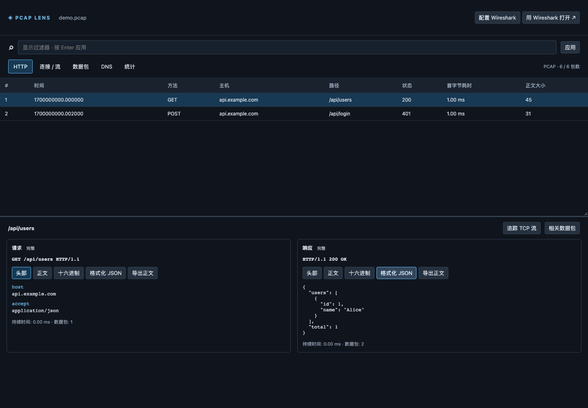

# Pcap Lens

**在 VS Code 中直接查看抓包，从 HTTP 请求追踪到 TCP 流和原始字节。**

Pcap Lens 是一个以 HTTP 接口排障为核心的轻量离线流量分析扩展。点击 `.pcap` 或 `.pcapng` 文件，即可查看请求与响应、追踪双向通信、检查协议字段和流量统计，无需另行安装 TShark、Python 或抓包驱动。

本机窗口在本机解析，Remote SSH 窗口在远程工作区解析；分析结果经 VS Code 通道传到界面，不上传第三方服务，也不包含遥测。界面支持中文和英文，并跟随 VS Code 的语言设置。

[快速开始](#快速开始) · [过滤示例](#过滤示例) · [开发与测试](#开发与测试) · [文档](#文档)

> 当前版本为 **0.1.3 试用版**，尚未发布到 VS Code 扩展市场。面向 Windows、macOS 和 Linux 桌面端开发；macOS 扩展宿主验证已通过，Windows／Linux 实机验证仍待完成。

## 界面预览



_使用仓库内合成抓包生成的 Webview 界面预览，不包含真实业务流量。_

## 功能

| 视图          | 能做什么                                                                                               |
| ------------- | ------------------------------------------------------------------------------------------------------ |
| **HTTP**      | 配对 HTTP/1.0、HTTP/1.1 请求与响应；查看方法、主机、路径、状态码、首字节耗时和正文大小；对照头部与正文 |
| **连接 / 流** | 查看通信端点，按方向追踪 TCP 内容；切换文本和十六进制；保留缺失片段及异常判断依据                      |
| **数据包**    | 查看协议字段树、原始十六进制和 ASCII；点击字段与字节双向定位                                           |
| **DNS**       | 配对 UDP/TCP 上的 DNS 请求与响应，展示域名、查询类型、解析结果、耗时和响应状态                         |
| **统计**      | 查看整体包数、字节数，以及各连接双向包数、字节数和持续时间                                             |

其他能力：

- **HTTP 正文处理**：JSON 格式化、chunked 解码、受资源预算约束的 gzip 解压；图片和其他二进制内容以十六进制展示，支持导出正文。
- **TCP 异常提示**：标记连接重置、疑似重传或乱序、流中的缺失字节，并提供判断依据。
- **共享过滤器**：支持可扩展的 Wireshark 风格语法子集；按 Enter 应用，错误表达式保留上一次有效结果。
- **上下文跳转**：从 HTTP 记录进入所属 TCP 流或相关数据包，再返回此前视图。
- **Wireshark 集成**：遇到复杂问题，一键使用本机已有的 Wireshark 打开原始文件。

## 快速开始

### 1. 从源码生成安装包

准备 Node.js 22 和 npm，获取项目源码后，在项目根目录运行：

```sh
npm ci
npm run typecheck
npm test
npm run package
```

根目录会生成 `pcap-lens-0.1.3.vsix`。打包命令自动构建扩展、Worker 和 Webview，无需全局安装 VSCE。

### 2. 安装到 VS Code

需要 VS Code **1.95.0 或更高版本**。

1. 打开 VS Code 命令面板。
2. 执行 **Extensions: Install from VSIX…**。
3. 选择生成的 VSIX，按提示重新加载窗口。

如果已经配置了 `code` 命令，也可以运行：

```sh
code --install-extension pcap-lens-0.1.3.vsix
```

### 3. 打开抓包

在 VS Code 文件列表中点击 `.pcap` 或 `.pcapng`，即可自动进入分析界面。可以先打开仓库中的 [demo.pcap](fixtures/demo.pcap) 或 [demo.pcapng](fixtures/demo.pcapng) 体验 HTTP 和 DNS 视图。

更多说明见 [使用指南](docs/USAGE.md) 和 [VSIX 打包指南](docs/PACKAGING.md)。

## 过滤示例

```text
http && tcp.port == 80
http.response.code >= 400
http.request.method == "POST"
http.request.uri contains "/api"
ip.addr == 10.0.0.1 && !dns
tcp.flags.reset == 1
dns.qry.name contains "example.com"
```

支持比较、`contains`、逻辑与或非和括号组合。输入过程中提供字段补全，按 Enter 应用。

HTTP／DNS 记录的任意一侧匹配时，界面保留完整配对上下文；统计只计算实际匹配的数据包。当前实现是 Wireshark 语法的子集，完整字段与语义见 [使用指南](docs/USAGE.md#filters)。

## Remote SSH

支持在 SSH 窗口打开远程抓包。请将扩展安装到 **SSH: 目标主机**，解析在远程服务器执行，正文导出默认位于远程目录。分析结果（包括正文与原始字节）通过 VS Code 通道显示在本机。

操作步骤与验证范围见 [Remote SSH 使用说明](docs/REMOTE_SSH.md)。SSH 下不直接启动本机 Wireshark，请先下载抓包后在本机打开。

## Wireshark 配置

工具栏新增 **配置 Wireshark** 按钮，也可在命令面板执行 **Pcap Lens: 配置 Wireshark 应用路径**。支持选择应用或输入绝对路径，macOS 可直接选择 `.app`；通过校验后保存到用户设置。启动失败时可从错误通知进入配置。

仅在使用“用 Wireshark 打开”功能时需要安装 Wireshark。无法自动发现时，在 VS Code **用户设置**中配置可执行文件的绝对路径，例如 Windows：

```json
{
  "pcapLens.wiresharkPath": "C:\\Program Files\\Wireshark\\Wireshark.exe"
}
```

macOS 常见路径为 `/Applications/Wireshark.app/Contents/MacOS/Wireshark`；Linux 应填写本机实际路径，例如 `/usr/bin/wireshark`。工作区设置不能指定要运行的可执行文件。

## 支持范围与限制

- **文件和协议**：pcap、pcapng；Ethernet、VLAN、IPv4／IPv6、TCP、UDP、明文 HTTP/1.x 和 DNS。
- **暂不支持**：实时抓包、TLS 解密、HTTP/2、WebSocket 解码和 IP 分片重组。
- **分析准确性**：TCP 异常属于基于抓包的观察；缺包不一定代表网络丢包。HTTP 使用连接内 FIFO 配对，缺失完整消息时配对可能存在不确定性。无法识别的内容仍可查看原始字节。
- **资源边界**：单份抓包最多 8 MiB／20,000 个包；单条 HTTP 正文最多保留 4 MiB，整份抓包累计最多保留 8 MiB；Worker 超时为 15 秒。
- **显示边界**：记录分批展示；文本／JSON 正文预览最多 256 KiB，完整保留正文可导出。敏感字段原样展示，不自动脱敏。

目标使用场景是约 **10–2000 KB** 的日常排障抓包。详细边界见 [安全说明](docs/SECURITY.md#当前资源上限)。

## 开发与测试

解析核心使用 **TypeScript**，后台任务运行在 **Node Worker**，界面采用 **React + Vite**。解析核心不依赖 VS Code 或 React，通过内部分析流水线和字段／运算符注册机制支持源码扩展。

```text
src/
├── core/          # 文件读取、协议解析、流重组、过滤与资源预算
├── extension/     # 自定义编辑器、文件访问、Worker 与 Wireshark 集成
└── ui/            # 分析界面、详情组件与中英文文案

docs/              # 使用、打包、架构和安全文档
fixtures/          # 合成抓包样例
tests/             # 功能、安全、Webview 与扩展宿主测试
scripts/           # 构建和测试入口
```

| 命令                     | 用途                                                    |
| ------------------------ | ------------------------------------------------------- |
| `npm run build`          | 构建扩展、解析 Worker 和 Webview                        |
| `npm run typecheck`      | TypeScript 类型检查                                     |
| `npm test`               | 功能及安全回归测试                                      |
| `npm run test:ui`        | 使用本机 Google Chrome 运行 Webview 回归                |
| `npm run test:extension` | 使用隔离的 VS Code 扩展宿主测试，默认下载测试版 VS Code |
| `npm run package`        | 生成本地 VSIX 安装包                                    |
| `npm run demo`           | 重新生成合成抓包样例                                    |
| `npm run format`         | 格式化源码与文档                                        |

在项目中按 **F5** 可启动扩展开发宿主。扩展宿主测试也可通过 `PCAP_LENS_VSCODE_PATH` 使用已有 VS Code 可执行文件。

当前验证记录包括 22 项功能／安全测试、Webview 交互回归和 macOS 扩展宿主测试。仓库提供 [三平台 CI 配置](.github/workflows/ci.yml)，实际运行结果以仓库 Actions 为准；本地记录见 [验证文档](docs/VALIDATION.md)。

## 参与贡献

欢迎改进协议解析、过滤字段、统计和界面。提交改动前请：

1. 阅读 [架构与源码扩展指南](docs/ARCHITECTURE.md)，保持解析、宿主和界面职责分离。
2. 为解析改动补充正常、截断和恶意输入测试，并保留原始数据包关联。
3. 新增界面文案时同时补充中文与英文。
4. 运行类型检查和相关测试；涉及界面时补充交互验证。

报告问题时，请注明扩展版本、VS Code 版本、操作系统、复现步骤和预期结果。抓包样例应使用合成或已脱敏数据，避免公开 Cookie、令牌及业务内容。

## 文档

- [使用说明](docs/USAGE.md)
- [Remote SSH 使用说明](docs/REMOTE_SSH.md)
- [VSIX 打包说明](docs/PACKAGING.md)
- [扩展市场发布指南](docs/PUBLISHING.md)
- [架构与扩展指南](docs/ARCHITECTURE.md)
- [安全检查与资源上限](docs/SECURITY.md)
- [验证记录](docs/VALIDATION.md)
- [更新日志](CHANGELOG.md)

## 许可证

本项目采用 [MIT License](LICENSE)。随构建产物分发的第三方许可证见 [THIRD_PARTY_NOTICES.md](THIRD_PARTY_NOTICES.md)。
